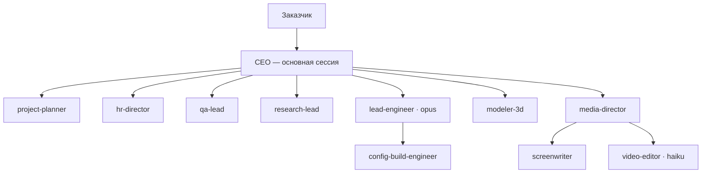

# Штатное расписание и план расширения

_Владелец: hr-director · обновлено 2026-11-20 · фактический ростер: `./dzm roster` и `ROSTER.md`_

## Оргструктура

## Почему именно такой состав
| Роль | Зачем | Почему не больше |
|---|---|---|
| project-planner, hr-director, qa-lead, modeler-3d, media-director, screenwriter, video-editor | обязательные роли первого задания | — |
| research-lead | раздел 4 задания: исследовательский отдел и база знаний | один руководитель; помощники — по объёму вопросов |
| lead-engineer (opus) | компания пишет код модов, а программистов в базовой структуре нет; архитектура и сложный Enforce Script требуют сильной модели | один архитектор вместо отдела: пока нет проектов |
| config-build-engineer (sonnet) | конфиги, XML CE и сборка — массовая работа, которую дорого делать на opus | — |

Сознательно не созданы: библиотекарь базы знаний (индекс и поиск делает `./dzm` бесплатно), отдельный CTO (покрывает lead-engineer), звукорежиссёр и аниматор (нет проектов).

## Триггеры найма помощников
Нанимаем по одному и только при появлении задачи на доске (`/hire`).

| Отдел | Помощник (модель) | Когда нанимать |
|---|---|---|
| Engineering | vehicle-systems-engineer (sonnet) | проект с механикой транспорта (сиденья, люки, турели, физика) |
| Engineering | network-engineer (opus) | сложная синхронизация: много состояний, несколько игроков, JIP |
| Engineering | ui-engineer (sonnet) | новый интерфейс: меню, HUD, layout |
| Engineering | animation-engineer (sonnet) | CfgMoves, новые анимации и команды персонажа |
| 3D_Art | hull-modeler, interior-modeler, uv-specialist, texture-artist, lod-optimizer (sonnet) | крупный заказ на технику или здание: больше 2 моделей или больше 1 недели работы |
| 3D_Art | weapon-modeler (sonnet) | проект с новым оружием |
| QA | qa-config-tester (haiku) | больше 20 конфигов или XML на проверку за этап |
| QA | qa-script-reviewer (sonnet) | больше 1000 строк Enforce Script за этап |
| Research | engine-api-researcher (sonnet) | разбор ванильных скриптов для нескольких систем параллельно |
| Research | community-scout (haiku) | после открытия доступа к Steam и форумам: обзоры похожих модов |
| Media | motion-designer (sonnet) | ролики с титрами и графикой сложнее шаблона |

## Правила вывода из штата
Временный помощник выводится из штата после закрытия проекта (`./dzm hr retire`). Постоянный сотрудник — если 2 месяца нет задач или его роль поглощена другой.
