# 20.11.2026 · Исправление ошибок RF_Humvee и файла спавна техники

_Зеркало записи в Google-журнале компании. Время московское (МСК). Картинки — `2026-11-20/img/`._

## Итог
Исправлены 8 ошибок: BUG-0001 в файле спавна техники и семь в моде RF_Humvee (BUG-0003, 0005, 0006, 0007, 0008, 0009, 0011). Исправления запушены в ветку мода `ccr-1682cad6-sct7q3`, PBO пересобраны. BUG-0002 оставлен по решению заказчика.

Открыты:
- BUG-0004 — репозиторий публичный, нужно действие заказчика;
- BUG-0010 — формат карты нормалей, проверка в TexView на ПК.

Второй круг QA (проверка сборки, BUG-0009, BUG-0011) — после сброса лимита использования, около 16:50 МСК. Компиляция скриптов и игровые проверки не выполнялись: нужен тест на ПК по сценарию ниже.

## Хронология
| Время (МСК) | Событие |
|---|---|
| 15:28 | Решения заказчика: журнал в Google Docs (документ создаёт заказчик), картинки временно в ветке GitHub, исправления пушить в ветку мода, BUG-0002 задуман |
| 15:30 | Кадры «до» по BUG-0001, 0003, 0005, 0006, 0007 |
| 15:32 | Старт исправлений: config-build-engineer, lead-engineer и modeler-3d работают параллельно |
| 15:34 | Исправлены BUG-0001, BUG-0003, BUG-0007 (config-build-engineer) |
| 15:40 | Исправлен BUG-0006: текстуры 2048 (modeler-3d) |
| 15:41 | Исправлен BUG-0005: формат сохранения люка (lead-engineer); найден BUG-0008 |
| 15:44 | Исправлен BUG-0008: действия люка из салона на игроке (lead-engineer) |
| 15:46 | QA, круг 1: закрыты BUG-0001, 0003, 0005, 0006, 0007, 0008; найдены BUG-0009, 0010, 0011 |
| 15:49 | У config-build-engineer сработал лимит использования sonnet (сброс 16:50). Оставшееся выполнил CEO |
| 15:51 | Исправлены BUG-0011 и BUG-0009, пересобраны PBO |
| 15:52 | 5 коммитов отправлены в ветку мода `ccr-1682cad6-sct7q3` |

## Ошибки
| Ошибка | Критичность | Что сделано | Статус |
|---|---|---|---|
| BUG-0001 · файл спавна не парсится | S1 | добавлен `</event>` после строки 45 | закрыта 15:46 |
| BUG-0002 · общий пул точек | S3 | оставлено по решению заказчика | WONTFIX |
| BUG-0003 · нет PROVENANCE.md | S2 | создан PROVENANCE.md | закрыта 15:46 |
| BUG-0004 · мод в публичном репозитории | S2 | нужно сделать репозиторий приватным | ждёт заказчика |
| BUG-0005 · сохранение люка без версии | S3 | метка RFHT и версия, старые записи читаются | закрыта 15:46 |
| BUG-0006 · текстуры 4096 по 11 МБ | S3 | 2048×2048, 42,7 → 10,7 МБ | закрыта 15:46 |
| BUG-0007 · M1114, «люк стрелка» | S4 | M1025, «люк на крыше» | закрыта 15:46 |
| BUG-0008 · люк из салона не всегда | S2 | действия перенесены на игрока | закрыта 15:46 |
| BUG-0009 · мусорный файл при сборке | S4 | путь rvmat от папки данных | на повторной проверке |
| BUG-0010 · нормаль и smdi в DXT1 | S3 | нужна проверка в TexView | открыта |
| BUG-0011 · «на крыше на крыше» | S4 | повтор убран | на повторной проверке |

### BUG-0001 · файл спавна техники не парсится
Найдена 13:57, исправлена 15:34 (config-build-engineer), повторный тест QA 15:46 — PASS.
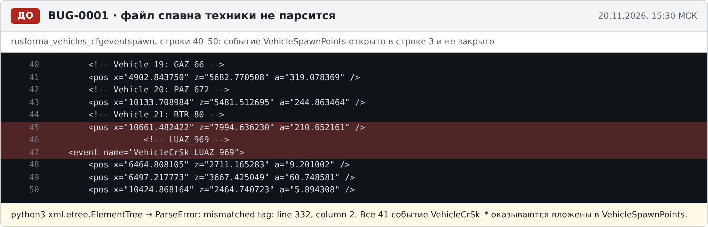 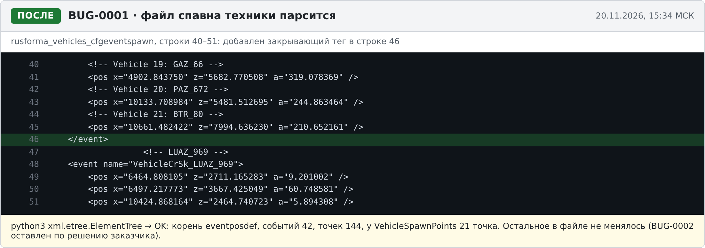

### BUG-0003 · нет PROVENANCE.md
Найдена 14:52, исправлена 15:34, PASS 15:46. В истории ветки чужая модель CC-BY была в коммитах bb1eccc и ecbcb60, а не в диапазоне, как было записано в отчёте аудита. Исправлено по git-истории.
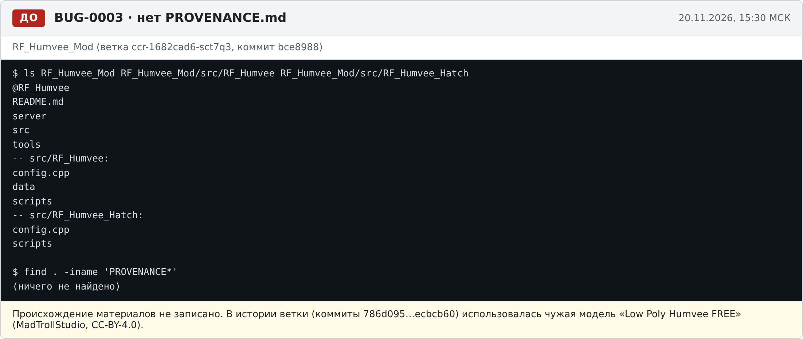 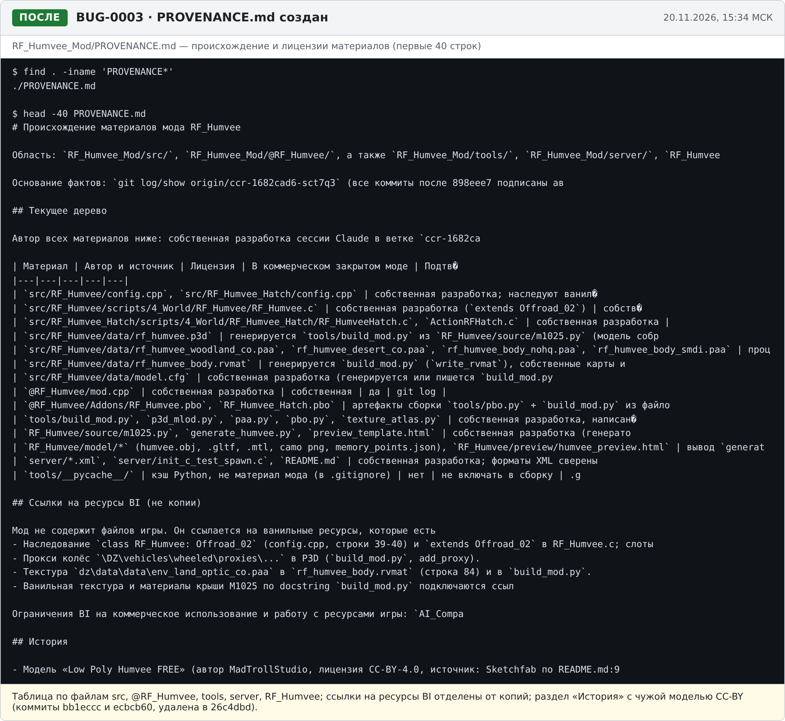

### BUG-0005 · сохранение люка без версии формата
Найдена 14:52, исправлена 15:41 (lead-engineer), PASS 15:46 по исходникам. Гипотеза H1 (движок пропускает непрочитанный хвост записи) проверяется на сервере.
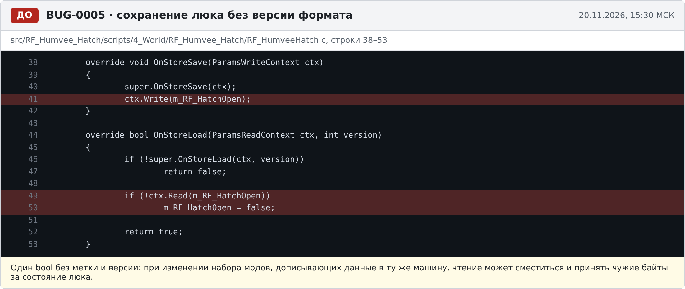 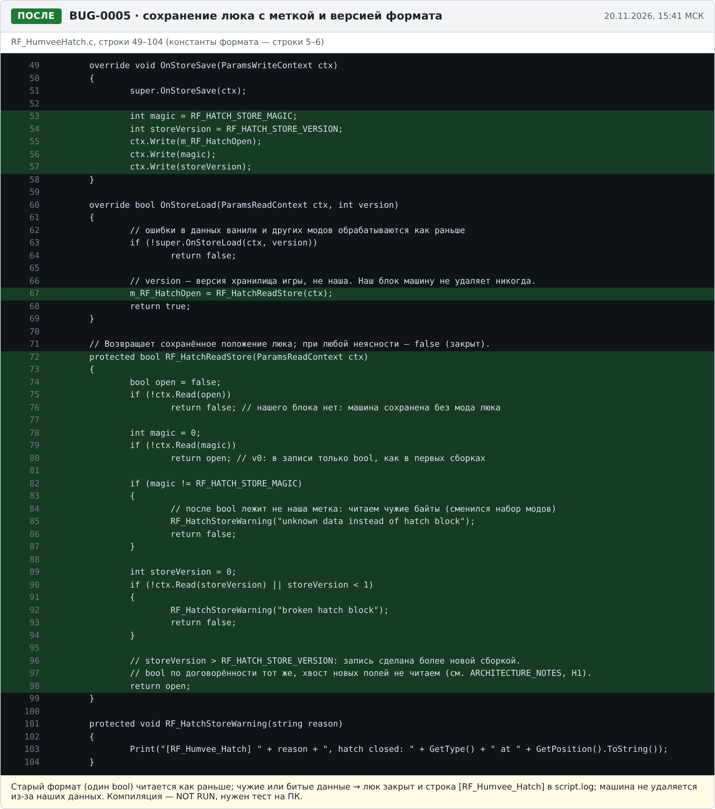

### BUG-0006 · тяжёлые текстуры
Найдена 14:52, исправлена 15:40 (modeler-3d), PASS 15:46 по размеру. Цена исправления: детализация вблизи ниже. Надписи нарисованы запасным шрифтом DejaVu, потому что на Linux нет Bahnschrift; на ПК с Windows сборка даст прежний шрифт. Формат нормали вынесен в BUG-0010.
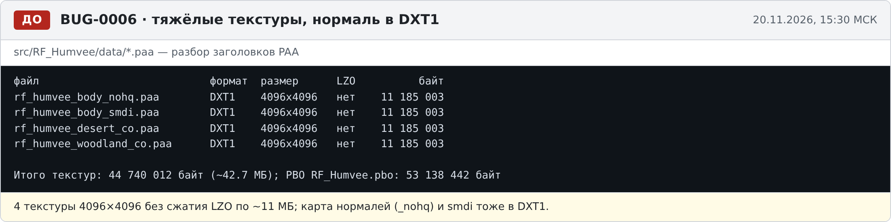 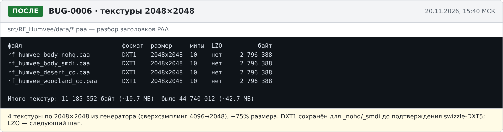
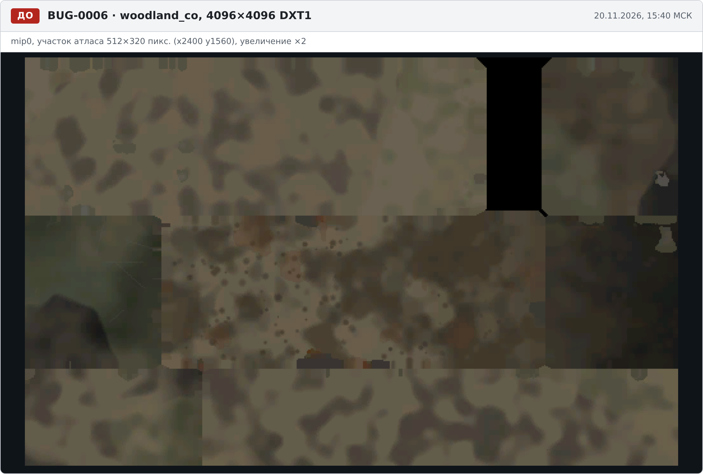 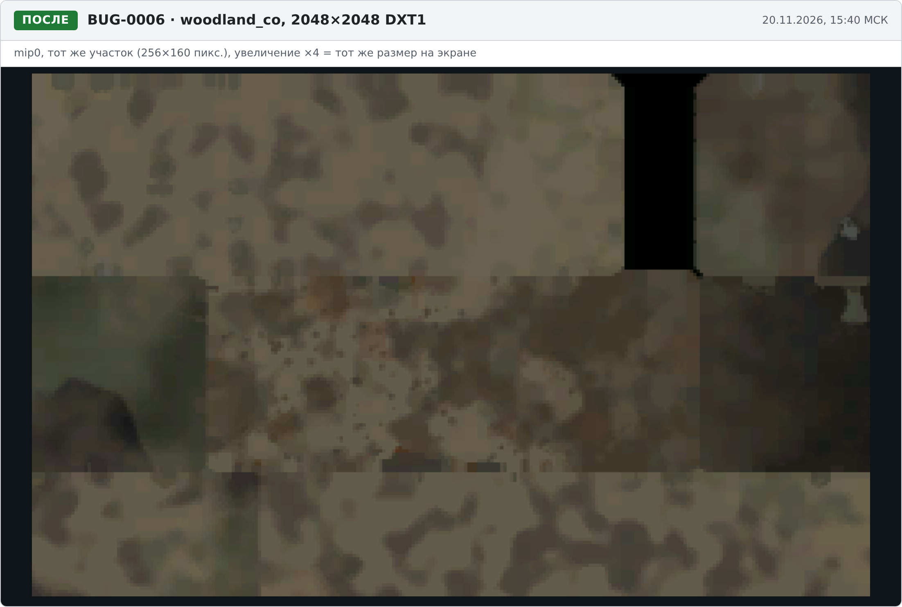
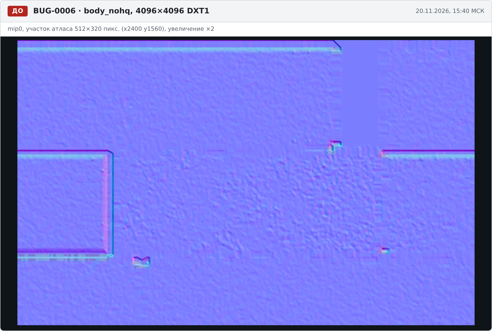 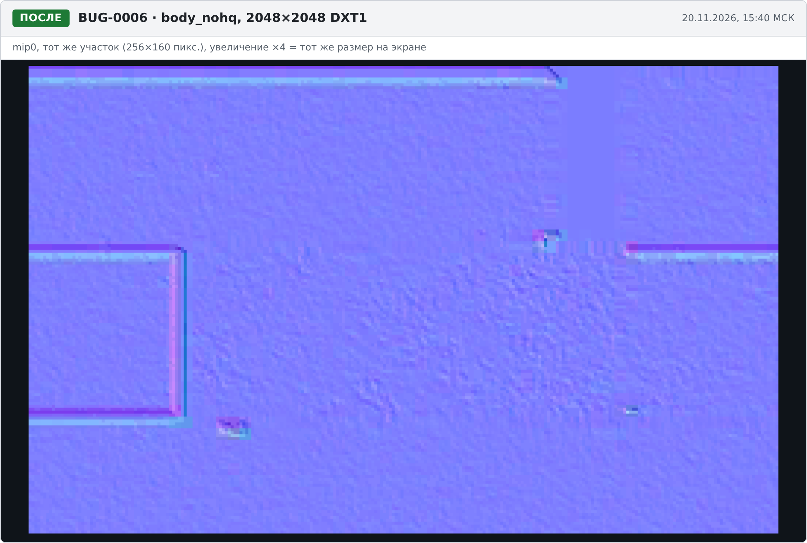

### BUG-0007 · название M1114 и «люк стрелка»
Найдена 14:52, исправлена 15:34, PASS 15:46.
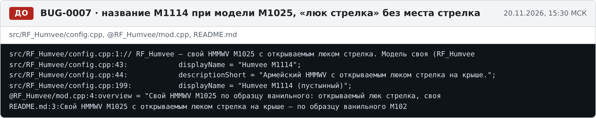 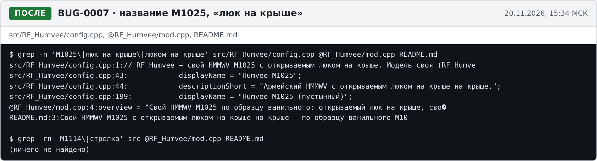

### BUG-0008 · «Открыть люк» изнутри машины появляется не всегда
Найдена 15:41 архитектором при ответе на вопрос QA, исправлена 15:44, PASS 15:46 по исходникам (сигнатуры сверены с официальными скриптами BI 1.30).
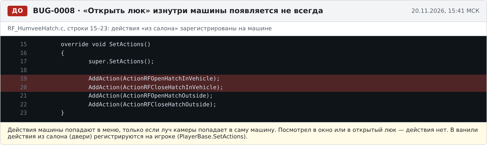 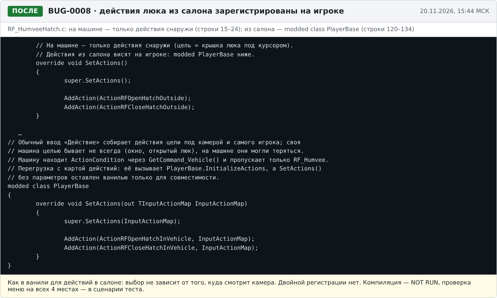

### BUG-0011 · опечатка после исправления BUG-0007
Найдена QA в 15:46, исправлена CEO в 15:51.
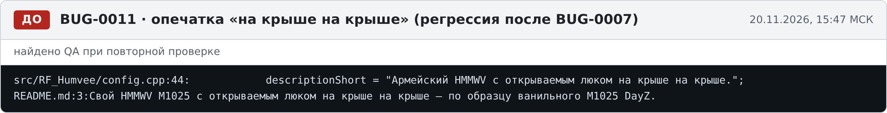 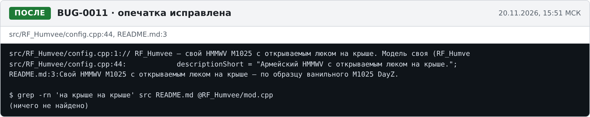

### BUG-0009 · сборка на Linux пишет rvmat в файл с обратными слэшами
Найдена QA в 15:46, исправлена CEO в 15:51. Путь строится от `src/RF_Humvee/data`, содержимое rvmat идентично.
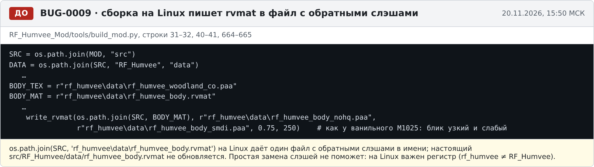 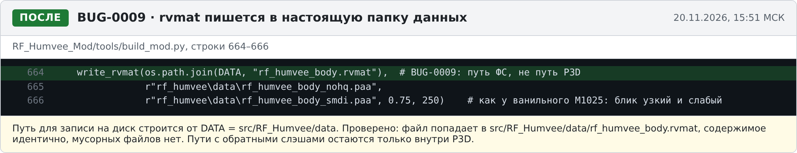

## Сборка
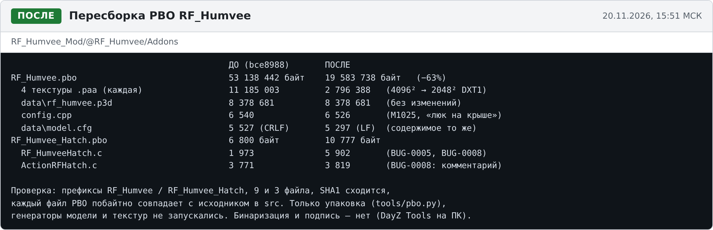

Коммиты в ветке мода: 05aa071 (BUG-0003), 0ac2dcf (BUG-0007, 0011), 1e3ce6c (BUG-0005, 0008), e0895d6 (BUG-0006, 0009), 3bb65ea (PBO).

## Что проверить на ПК
Сервер и клиент с `@RF_Humvee`, ключи `-dologs -adminlog -scriptDebug=true`, `verifySignatures=0`.
- Старт без ошибок RF_Humvee в `script_*.log` и `*.RPT`.
- Название в игре — «Humvee M1025».
- На каждом из 4 мест «Открыть люк / Закрыть люк» есть при любом направлении взгляда, без дубля. В Offroad_02 и пешком его нет, снаружи работают действия Outside.
- Старая машина с открытым люком после обновления мода и рестарта на месте, люк открыт. Снять аддон люка и вернуть: машины на месте, предупреждений `[RF_Humvee_Hatch]` нет.
- Два клиента видят одно положение люка, в том числе зашедший позже.
- Текстуры 2048 на игровой дистанции и вблизи: приемлемо ли качество.
- Прислать `script_*.log`, `*.RPT`, скриншоты.

## Затраты
config-build-engineer 39 832 токена, lead-engineer 121 613 (два захода), modeler-3d 57 912, qa-lead (круг 1) 36 153. Итого около 255 тыс. токенов. Расход основной сессии виден в `/usage`.
