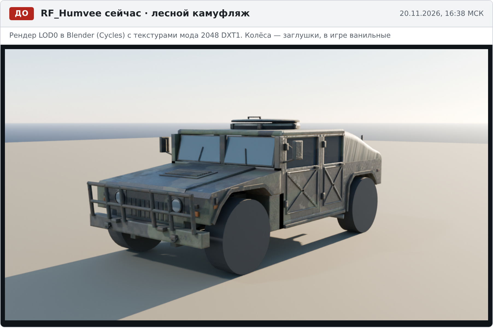
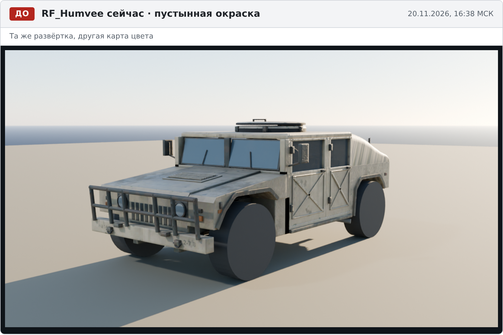
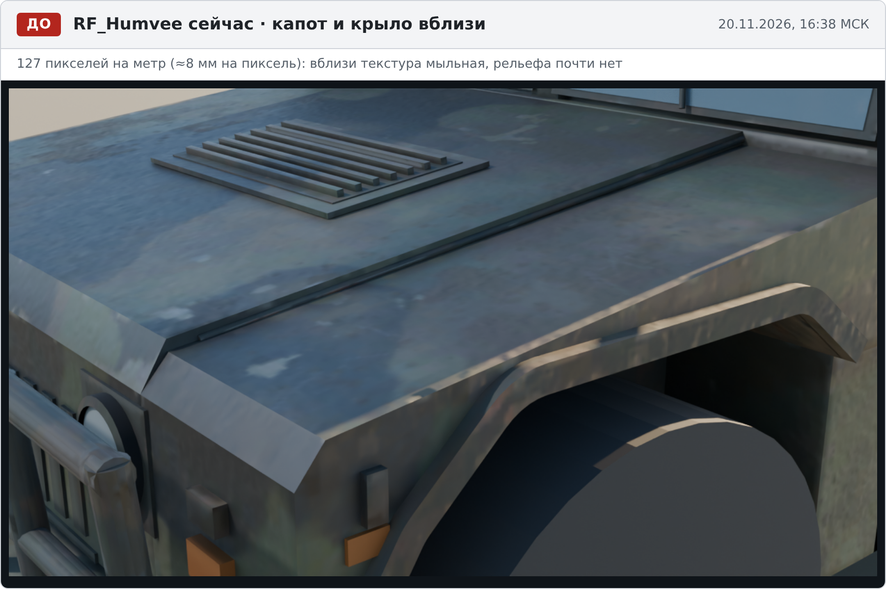
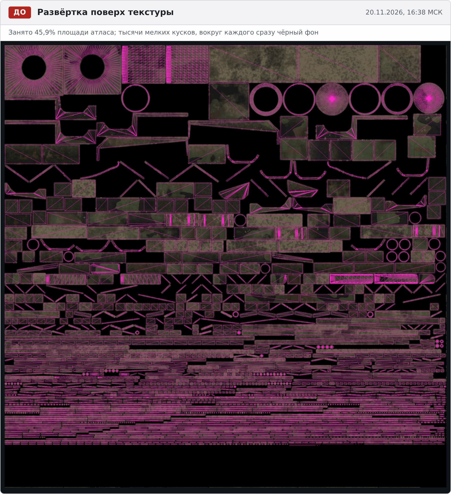

# 20.11.2026 · Разбор текстур RF_Humvee: что улучшить

_Копия записи в Google-журнале компании. Время московское (МСК). Картинки — `2026-11-20/img/`. Полный разбор: `Projects/Active/PRJ-0004_rf_humvee_mod_hammera_m1025/TEXTURE_REVIEW.md` (задача T-0054, QA PASS)._

**Запрос.** В 16:24 заказчик попросил посмотреть текстуру машины и написать, что улучшить или доделать, чтобы в игре она смотрелась лучше.

**Как делали.** 16:25–16:38 CEO перевёл текстуры в PNG, наложил развёртку на атлас, измерил плотность и отрендерил модель в Blender. 16:38–16:40 разбор сделал modeler-3d. В 16:45 QA сверил цифры и ссылки на код и вернул один неверный вывод на исправление, в 16:47 после исправления — PASS.

**Итог.** Машина узнаётся и издалека выглядит прилично, но вблизи текстура мыльная и «картонная», а фары, стопы и повреждения визуально не работают. Причины: низкая плотность текстуры, развёртка из тысяч мелких кусков без запаса цвета, почти нулевой блик и плоская карта нормалей. Мод не менялся: ждём решения заказчика.

## Как выглядит сейчас
 
 

- Вблизи мыльно: 127 пикселей на метр, около 8 мм на пиксель, одинаково на капоте, в салоне и на днище.
- Развёртка из тысяч мелких кусков занимает 46% текстуры. Вокруг кусков сразу чёрный фон, поэтому на 10–30 м по швам пойдут тёмные кромки.
- Блика почти нет (зелёный канал `_smdi` около 7 из 255), карта нормалей почти плоская: краска выглядит как матовый картон.
- Фары, стопы и задний ход не загорятся: в видимой модели нет выделений `light_*`, хотя порядок в config правильный. Повреждения не видны: в `healthLevels` нет материалов.
- Издалека (LOD3) грани берут цвет из узкой полосы атласа с чёрными участками: возможны тёмные пятна.
- Стекло, фонари и тёмные детали (около 8 000 граней) без материала: плоский цвет без отражений.

## Что улучшить
**Быстро, без переделки модели:** запас цвета 8–16 px во всех картах; блик по зонам (краска, металл, резина, стекло); детальная карта в материале; рельеф в нормали (швы, заклёпки, рёбра, вмятины); материалы стекла и тёмных деталей; надписи свободным трафаретным шрифтом (OFL).

**Средне:** фары, стопы, задний ход, приборка (выделения `light_*` и материалы «вкл/выкл»); материалы повреждений; развёртка LOD1–3 на чистые участки атласа; пыль и грязь снизу вверх; отдельный материал салона; запечь затенение (AO) с текущей модели (предложение CEO).

**Крупно:** новая развёртка крупными островами и два материала (кузов 2048, мелочь и салон 1024); запекание нормали и AO с детальной модели; сверка вида с ванильными колёсами в игре.

## Первый пакет, около 135 тыс. токенов
- Запас цвета во всех картах и перерендер «до/после» — около 25 тыс.
- Развёртка LOD1–3 на чистые участки атласа — около 25 тыс.
- Новый `_smdi` по зонам — около 40 тыс.
- Рельеф в нормали и новые надписи — около 45 тыс.
- Тест на ПК заказчика: `_smdi` и `_nohq` в TexView, фары, вид с 1, 30 и 100 м.

## Затраты
modeler-3d 53 539 токенов (разбор и исправление), qa-lead 19 849 (проверка и повтор). Подготовка материалов и рендер — основная сессия.
